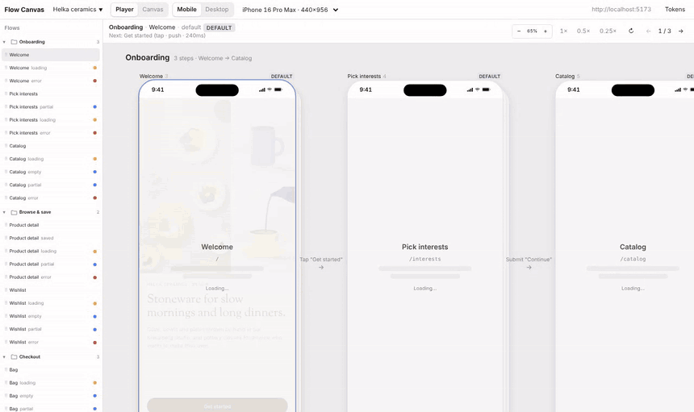
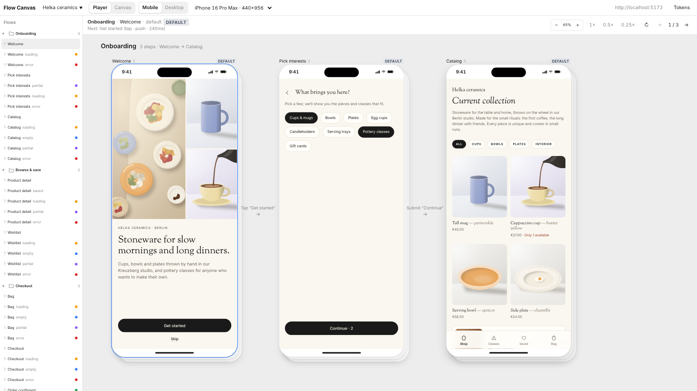
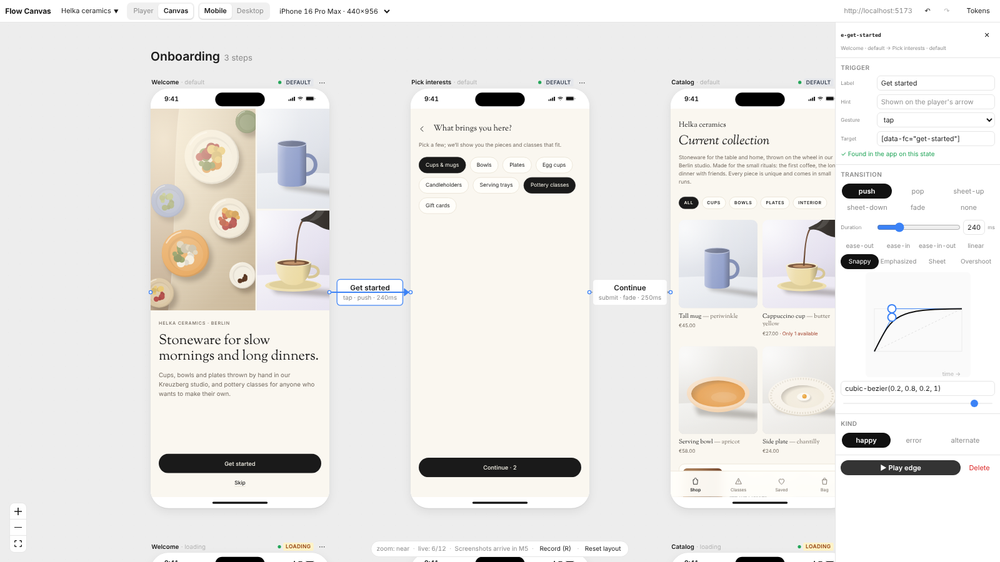
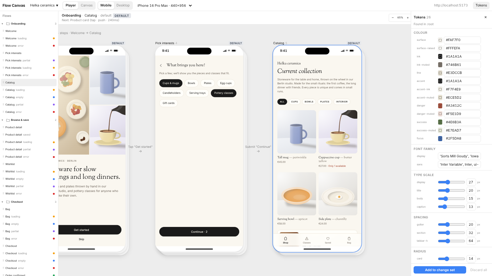

# Flow Canvas

A Chrome extension that turns any app running on `localhost` into a live map of its screens, states and flows. Open it on your dev server and every route appears as a live frame on a canvas. Click through the app to record flows, force a screen into its loading, empty, partial or error state, play a flow on a phone frame with real transitions, and tweak design tokens across every frame at once.



- **No code change needed.** Live frames, device viewports, recorded flows and tokens work on any localhost app.
- **Add the SDK (under 10 lines) for states.** Every screen then shows its states side by side, one click each.
- **Flows live in your repo.** Everything is saved to `flowcanvas.config.json`, so flows are reviewed in pull requests like code.
- **Claude can read and edit the canvas** through a local MCP server: screens, edges, notes, comments and tokens.

## 60-second quick start

You need Node 20+, pnpm 10 and Chrome (or Edge, Arc, Brave).

```bash
git clone https://github.com/MaherFayad/canvas-flow.git flow-canvas && cd flow-canvas
pnpm install
pnpm --filter @flowcanvas/extension build      # → apps/extension/.output/chrome-mv3
pnpm --filter @flowcanvas/demo dev             # demo app on http://localhost:5173
```

1. Open `chrome://extensions`, turn on **Developer mode**, click **Load unpacked** and pick `apps/extension/.output/chrome-mv3`.
2. Open `http://localhost:5173` and click the Flow Canvas toolbar button. The canvas opens for that origin and starts discovering screens.
3. In the canvas, open the project menu (top left) → **Import config…** and drop `apps/demo/flowcanvas.config.json` to get the demo's sections, states and flows.
4. Press **→** to step through a flow in the Player, switch to **Canvas** to see every state, press **R** to record new edges by clicking inside a frame, and open **Tokens** to change colours and sizes live.
5. **Save** downloads `flowcanvas.config.json`; commit it to your app's repo.

On your own app: start its dev server, click the toolbar button on its tab, and go. Full walkthrough: [docs/getting-started.md](docs/getting-started.md).

## Screenshots

| Player | Canvas with the edge inspector | Tokens |
| --- | --- | --- |
|  |  |  |

## The three pieces

| Package | What it is | Docs |
| --- | --- | --- |
| **Extension** (`apps/extension`) | Chrome MV3 extension: the canvas, the Player, record mode, tokens, and two small content scripts that run only inside canvas frames on localhost. | [Getting started](docs/getting-started.md) |
| **`@flowcanvas/sdk`** (`packages/sdk`) | Optional, under 2 KB gzipped, zero dependencies. Lets the app show itself in a forced state and mark tap targets. A no-op outside the canvas and in production. Adapters for React, Next.js, Vue, MSW and Vite. | [SDK reference](docs/sdk.md) |
| **`@flowcanvas/mcp`** (`packages/mcp`) | Local MCP server so Claude can read and edit the canvas and `flowcanvas.config.json`. | [MCP tools](docs/mcp-tools.md) |

Shared contracts: `packages/protocol` (wire messages; a zod-free `/lite` entry for content scripts and the SDK) and `packages/config` (the config schema and migrations; JSON Schema in [docs/schema/v1.json](docs/schema/v1.json)).

## SDK in 10 lines

```bash
npm i -D @flowcanvas/sdk
```

```ts
// main.tsx (any framework)
import { fc } from '@flowcanvas/sdk';

fc.init({
  screens: [
    { id: 'welcome', path: '/', group: 'onboarding' },
    { id: 'catalog', path: '/catalog', group: 'onboarding', states: ['default', 'loading', 'empty', 'partial', 'error'] },
  ],
});
```

```tsx
// In a screen: render the state the canvas asks for.
if (fc.is('loading')) return <CatalogSkeleton />;
if (fc.is('error')) return <ErrorState />;

// Mark a trigger so recorded edges get a stable selector.
<button {...fc.target('get-started')}>Get started</button>
```

With Vite, `@flowcanvas/sdk/vite` turns `<button fcTarget="get-started">` into `data-fc="get-started"` and swaps the SDK for its no-op build in production. No SDK? The canvas falls back to its fetch/XHR mock layer, driven by the `mocks` in your config. Recipes: [Vite + React](docs/recipes/vite-react.md), [Next.js App Router](docs/recipes/nextjs.md), [Nuxt / Vue](docs/recipes/nuxt-vue.md), [MSW](docs/recipes/msw.md).

## Connect Claude (MCP)

```bash
# Claude Code, from the project folder
claude mcp add flowcanvas -- npx -y @flowcanvas/mcp --project .
```

```json
// Claude Desktop: claude_desktop_config.json
{
  "mcpServers": {
    "flowcanvas": {
      "command": "npx",
      "args": ["-y", "@flowcanvas/mcp", "--project", "/Users/maher/dev/helka"]
    }
  }
}
```

The server works on `flowcanvas.config.json` directly, and links to the open canvas tab over a WebSocket on `127.0.0.1` (ports 47800 to 47809, extension origin only). Try: "add an error state to Checkout, draw the retry edge, and leave a note on why". All 30 tools: [docs/mcp-tools.md](docs/mcp-tools.md).

## Privacy

The extension collects no data and makes no network calls of its own: it loads your localhost app in frames, and talks to the local MCP server on `127.0.0.1` when you run one. Screenshots stay on your machine. Details: [docs/PRIVACY.md](docs/PRIVACY.md).

## Develop

```bash
pnpm -r typecheck && pnpm -r test   # before every commit
pnpm lint                           # ESLint (flat config at the root)
pnpm -r build && pnpm size          # bundle budget: bridge.js and mock.js < 15 KB, SDK core < 2 KB gzip, extension < 1.5 MB
pnpm e2e                            # Playwright: Chromium with the unpacked extension against the demo
```

The plan and scope live in [docs/BUILD_PLAN.md](docs/BUILD_PLAN.md); defaults chosen for its open decisions are in [docs/DECISIONS.md](docs/DECISIONS.md). Changes: [CHANGELOG.md](CHANGELOG.md).

## License

[MIT](LICENSE) © 2026 Maher Fayad
